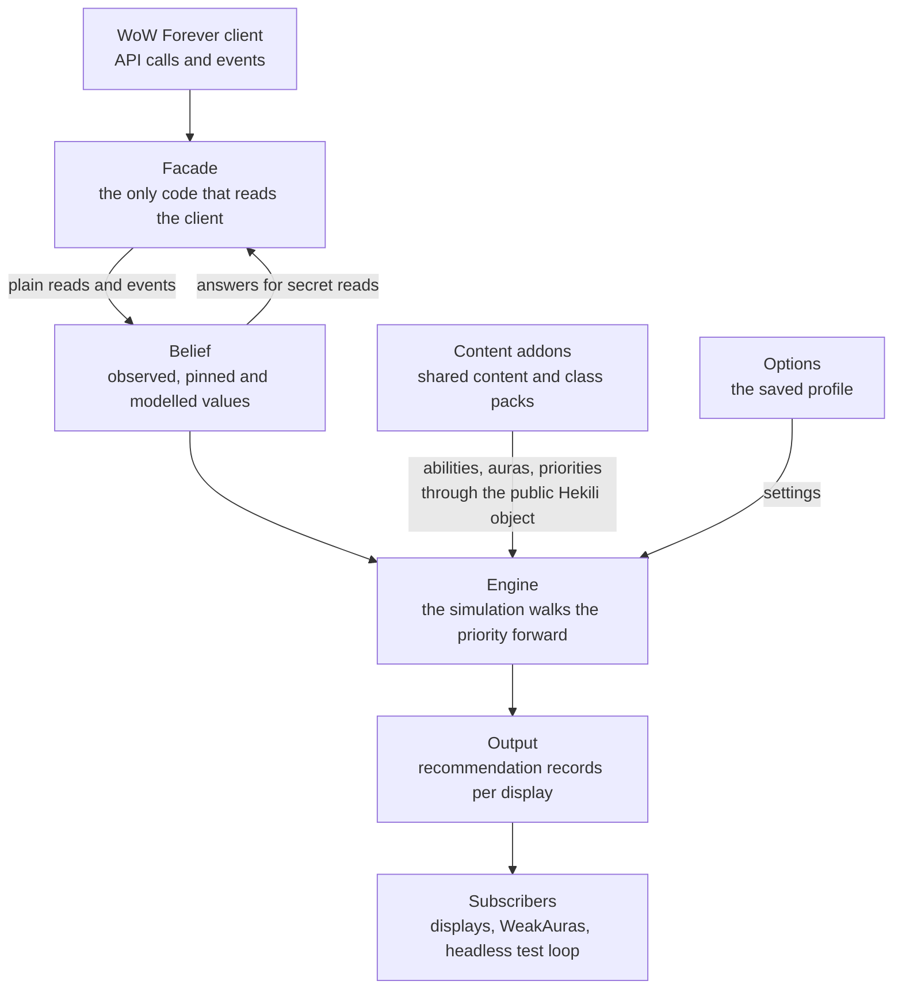

# Developing Hekili Forever

This guide takes you from a fresh clone to a merged change. It is written for two readers: a developer who has never
seen Hekili's implementation, and a priority author who wants to add or change a priority pack. It is the front door.
The detailed references stay where they are, and this guide links to them:

| Reference | What it holds |
| --- | --- |
| [architecture.md](docs/dev/architecture.md) | The layers, the engine's interface, the content surface, the packs |
| [layout.md](docs/dev/layout.md) | Every folder, the checks in detail, each pack's gate lines, in-game checkpoints |
| [wowsims-packs.md](docs/dev/wowsims-packs.md) | The rules for priority packs, the recipe, the translator, floors |
| [gaps.md](docs/dev/gaps.md) | Known differences from wowsims and where each must be fixed |
| [publishing/README.md](docs/publishing/README.md) | Packaging, releases and the CurseForge page |

## 1. What Hekili Forever is and how it works

Hekili Forever is a priority helper for the WoW Forever client. It shows the ability to press next and the few after
it. It never presses anything for you: it is a display, with no automation.

### Why the addon cannot simply read the game

WoW Forever runs on a modern client that hides many values from addons during combat. Resources, cooldown times, aura
durations, target health and combat statistics become "secret": an addon can hand them to the game's own frames, but
it cannot read, compare or calculate with them. The combat log is not available at all.

Upstream Hekili read all of those values on every update, so it cannot work as written. Hekili Forever keeps
Hekili's simulation and class model, and replaces the hidden reads with a **belief**: a running estimate of the game
state.

- The belief starts from values the client still answers plainly, such as out-of-combat reads, your own casts,
  "is this spell usable" answers and cooldown flags.
- It carries those values forward with the same models the class pack registers: costs, regeneration, durations.
- Each estimate is a band with a low, a best guess and a high, plus how it was learned: observed, pinned by an event,
  or modelled.
- When the client reveals something new, the belief corrects itself.

### The simulation and the display

On each update the engine copies the belief into Hekili's simulated state. It walks the active priority list, picks
the first ability whose conditions hold, advances the simulated clock past that cast, and walks the list again. That
repeated walk fills the queue of upcoming abilities.

The engine publishes the result as a set of recommendation records per display. The displays, the WeakAuras bridge
and the headless test loop all subscribe to those records. None of them reads the simulation directly.

### The layers



Each layer talks only to its neighbours. Content addons reach the engine only through the public registration
interface. The architecture reference has the full picture: [docs/dev/architecture.md](docs/dev/architecture.md).

## 2. Setup

### Clone and bootstrap

The checks run in a Linux shell. On Windows, use WSL.

1. Install [mise](https://mise.jdx.dev/), Python 3, Git, `make` and a C compiler.
2. Clone the repository on the `forever` branch, install the tools mise manages, install the Lua toolchain into the
   repository, and run the full check once to confirm the tree is green:

   ```sh
   git clone -b forever https://github.com/zmsl/hekili.git
   cd hekili
   mise install
   make bootstrap
   make check
   ```

The setup installs the following, none of it system-wide.

| Tool | Version | Installed by |
| --- | --- | --- |
| Lua (the game's Lua) and LuaRocks | 5.1.5 and 3.8.0 | the bootstrap, into `.lua/` |
| busted (tests), luacheck (lint), luacov (coverage) | 2.3.0, 1.2.0, 0.17.0 | the bootstrap, into `.lua/` |
| StyLua (formatter) | 2.5.2 | mise |
| lua-language-server (type check) | 3.19.1 | mise |
| Python | 3.13 | mise |

A new git worktree has no toolchain of its own. Run the bootstrap in it, or link its `.lua` folder to an existing one.

### What the full check covers

Run `make check` before every commit. CI runs the same steps on every push, except the type check.

- Lint, with luacheck.
- Formatting, with StyLua. Upstream Hekili files keep their own style and are skipped.
- The type check, with lua-language-server.
- The headless test suite, one process per spec file, in parallel. It includes the short replay and loop gates.
- A syntax check of every Lua file.
- The API checks: no file reads a game API except through the facade, and the engine and the displays stay on their
  own sides of the engine's interface.
- The packs check: regenerating every priority pack leaves the source tree unchanged.
- The offline tests of the release tools.

For a fast edit loop, `make test-fast` skips the long harness gates. To run one spec file:

```sh
.lua/bin/busted tests/Game/State/resources_spec.lua
```

### Link the addons into the game client

Each addon in `src/` gets its own directory link in the client's `_classic_beta_\Interface\AddOns` folder: the core,
the shared content and every class pack. The full list is in [docs/dev/layout.md](docs/dev/layout.md), under
"In game".

With the clone in WSL, open an elevated Windows command prompt in the AddOns folder and link each addon to its folder
in the clone, one line per addon:

```bat
mklink /D Hekili \\wsl.localhost\<distro>\home\<user>\src\hekili\src\Hekili
mklink /D Hekili_Shared \\wsl.localhost\<distro>\home\<user>\src\hekili\src\Hekili_Shared
```

With the clone on Windows, link to its `src` folders instead: `mklink /D Hekili C:\path\to\hekili\src\Hekili`.

Remove any installed copy of Hekili or Hekili Forever first, as the [README's Install section](README.md#install)
says. Hekili Forever keeps the original folder name and saved settings.

### Reload in the game

After adding or moving an addon folder, restart the client fully: a reload does not pick up a new folder. After
editing files, type `/reload`. `/hekili` opens the options.

## 3. Repository map

One rule explains the shape: **the core is a generic engine, and everything about a class lives in a pack.** The
shared addon holds the content every class uses. Nothing dev-only ships. Details are in
[docs/dev/layout.md](docs/dev/layout.md).

| Folder | What it is |
| --- | --- |
| `src/Hekili/` | The core addon: the facade, the belief, the engine and simulation, the displays and the options |
| `src/Hekili_Shared/` | Content every class shares: racials, consumables, items, common auras |
| `src/Hekili_<Class>/` | One class pack per class: the class file and its generated priorities |
| `src/Hekili_<Class>/APLs/` | The priority sources and the pack manifest; dev-only, never shipped |
| `tools/wowsims/` | The wowsims exporter, the translator and one recipe per supported spec |
| `tests/Game/` | Tests of the core, and the combat harness: the simulated client the gates fight in |
| `tests/Forever/` | Tests of the engine, the packs and the displays, the class worlds and the gate specs |
| `tests/Forever/wowsims/` | Each spec's exported wowsims request and fight log, checked in |
| `tools/` | Pack generation, the API and boundary checks, the release tools |
| `docs/` | References, specs, plans and research |
| `archive/` | Upstream class files from earlier expansions, kept for reference and never loaded |

## 4. How the core is developed

### The hard rules

These rules hold for every change to the core. The checks enforce most of them.

- **The core/pack boundary.** The core names no class, spell, aura, talent, form or rotation. It works only with
  what packs declare through the registration interface. Content addons, in turn, use only the public Hekili object,
  never the core's internals. The boundary test scans both sides. A few inherited simulation files still carry
  upstream names; each is held to a ceiling that may only fall.
- **Secret safety.** Only the facade reads the game client. Never compare a value, or calculate with it, unless it is
  known to be plain: test it with the client's secret check first, or take it from the belief.
- **No allocation on recurring paths.** Code that runs on every update or combat event creates no tables, closures or
  strings. Reuse preallocated records instead. Allocation tests cover the belief, the driver and the output.
- **The layering.** The client is read through the facade, turned into a belief, simulated by the engine and published
  to subscribers. The displays and options never read the simulation. The engine never reads the displays or the
  saved profile directly.

### Test first, headless

Every change starts with a failing test. The whole addon runs headless under busted against a fake client, so the
belief, the simulation and the displays are all testable without the game. The unit specs mirror the source tree. The
combat harness plays seeded fights against a model of the Forever client that hides what the real client hides, and
the gates run the shipped priorities in it (section 5).

`make bench` reports the time and memory each update costs in a headless fight. It is reported, not gated. Run it
when a change touches the update path, and compare it with a run on the base commit.

### Review and merge

Work happens on a branch from `forever`.

1. Keep `make check` green on every commit.
2. Run `make gate` before asking for a merge. It runs the full check, then every class's 20-fight loops.
3. Have the change reviewed against the rules above and the gate's output.
4. Merge into `forever`. Never force-push it.

A change that moves a gate line says why in its commit. A floor that drops is a failure, not a re-measurement.

## 5. How priority packs are developed

### The pure-translation rule

Every default priority is generated from wowsims.com. Each supported spec has one pack, named
"&lt;Spec&gt; (wowsims.com)": wowsims/forever's own action list, translated to this addon's keys. There are no
hand-built priorities.

A pack follows wowsims as closely as the Forever client allows. A difference the client forces, such as a value it
keeps secret, is recorded with its reason. A difference with any other cause is a gap. It is fixed in the layer that
is wrong: the class kit, the translator, the harness or the core.

Each spec has a **recipe**: the wowsims build to export (race, gear, talents, options) and the translation data. Most
translation data maps wowsims's spell IDs to this addon's keys. A few recipe keys add something wowsims does not
carry, and they are the only additions a pack may make:

| Key | Meaning |
| --- | --- |
| `leveling` | Filler lines for lower levels, appended to the list and silent at level 60 |
| `levelingFirst` | Lines put first, for a form the sim starts in and its list never casts |
| `extra` | A line inserted before a named action, for content wowsims cannot model; each use states its reason |
| `requires` | Runs an entry only once a named talent is taken |
| `settings` | A pack setting that a recipe line reads, so players can switch that line off |
| `focus` | An action's priority tier, so the timeline display shows it ahead of time |

[docs/dev/wowsims-packs.md](docs/dev/wowsims-packs.md) has the full recipe, the rules and the translator's behaviour.

### Regenerate

The pipeline runs from the recipe to the packs that ship. Run each step from the repository root.

1. Export the wowsims request and fight log for a spec. This needs a wowsims/forever checkout at the pinned commit and
   its command-line simulator. Most changes skip this step and use the checked-in log.
2. Translate every recipe into its priority source.
3. Write the generated priorities into the class files.

```sh
make wowsims-export SPEC=warrior_arms   # step 1, one spec
make wowsims-packs                      # step 2
make packs                              # step 3
```

The packs check in `make check` runs steps 2 and 3 and fails on any difference. Commit the regenerated files with the
change that caused them.

### The replay and the 20-fight loops

Two kinds of gate measure a pack.

- **The replay** runs the pack beside wowsims's own fight, from the checked-in log. At each of wowsims's casts it
  compares our first recommendation with what wowsims cast. Its line reports `decisions on-GCD`, the share of those
  casts we agreed with, and the top disagreements.
- **The loops** fight seeded mobs in the harness, twenty fights per pack. In the first run our addon drives and an
  oracle shadows it. The oracle is the same engine reading a client with no secrets, so it shows what perfect
  knowledge would pick. In the second run, on the same seeds, the oracle drives.

A loop's summary line starts like this:

```
Arms solo: fights=20 agreement 0.966 (16585 ticks); react median 0 p90 0 never 0.038; refused per 100 [...]; ...
```

| Field | Meaning |
| --- | --- |
| `agreement` | The share of ticks where our first recommendation matched the oracle's |
| `react` | Ticks until we show a new pick of the oracle's; `never` is the share we never showed |
| `refused per 100` | Presses the simulated client refused, by reason, ours beside the oracle's |
| `dps A/B` | Damage with our addon driving, over damage with the oracle driving |
| `flicker X/min (oracle Y)` | How often the first icon changes and changes back, ours beside the oracle's |

`make check` runs short 3-fight versions. `make test-<tag>` runs one class's 20-fight loops (for example
`make test-druid`), and `make gate` runs all of them. The current lines for every pack are in
[docs/dev/layout.md](docs/dev/layout.md).

### Floors only rise

Each gate has a **floor**: the lowest score it accepts. A floor is set from the first clean measurement and raised
whenever a change lifts the score. It is lowered only with a named, accepted cause, written beside the number. This
keeps every improvement and makes any regression visible.

### Flicker is an acceptance metric

Jittery recommendations are a defect, so flicker is judged beside agreement. A change that raises a pack's flicker
needs a reason, and flicker has floors of its own. Between two equally good fixes, prefer the one that keeps the
display still.

A pack change is merged like a core change (section 4). Its review also checks that the pack still mirrors wowsims,
that every addition uses one of the recipe keys above, and that no floor fell.

### Adding a class

A new class pack touches these places. The per-spec procedure is in
[docs/dev/wowsims-packs.md](docs/dev/wowsims-packs.md) and the plan it links.

1. The addon folder, with its TOC and class file, added to the list of addons the tests load.
2. The kit: the class's abilities, auras and talents, with values from the game's DB2 data.
3. The class world: the harness's model of the class for the loops.
4. The learn table: the level at which each ability is learned (`make wowsims-learn CLASS=<TOKEN>`).
5. The recipe and the export for each spec.
6. The replay and loop floors, measured on the first clean run.
7. The rows in the docs: the gate lines in the layout reference, and the class in the README.
8. The packager's folder and ignore lists, the package check and the in-game link list.

## 6. Checking in the game client

The headless harness models the client, but it cannot see everything:

- which values the real client keeps secret in each situation;
- the exact order and timing of real events;
- how the displays look and feel in play;
- anything the harness models from an assumption rather than a measurement.

Changes in those areas need an in-game check. Forever has no target dummies, so checks happen on open-world mobs.

- **Snapshots.** Type `/hek snap` while a recommendation is wrong. Open `/hekili`, go to "Snapshots
  (Troubleshooting)", and copy the snapshot. It records the simulation's walk through the priority and why each
  entry was or was not picked.
- **The in-game ledger.** Questions that only the client can answer are tracked as a ledger, each with what to do and
  what to report. Today they are listed under "In game" in [docs/dev/layout.md](docs/dev/layout.md).
- **Probe addons.** A question about the client itself, such as whether a value is secret in combat, is answered with
  a small throwaway probe addon, not with Hekili. Its findings become facts that the belief and the harness rely on.

An in-game answer that differs from the model is a gap. Record it in [docs/dev/gaps.md](docs/dev/gaps.md).

## 7. Conventions and releases

- **Changelog.** Every change a player can see adds a line under "Unreleased" in [CHANGELOG.md](CHANGELOG.md), in the
  same commit. Write it for players, not developers.
- **Floors.** Floors only move up. A floor goes down only with a named cause recorded beside it.
- **Flicker.** A change that raises flicker says why. A quieter mechanism beats a jumpier one.
- **Versioning.** Releases are tagged `vMAJOR.MINOR.PATCH`. A pre-release adds a suffix such as `-rc.1` and ships as
  a beta. Every addon in the zip carries the same version.
- **Releasing.** A release is three steps: push the tag, read the draft release the workflow builds, then publish it.
  Publishing uploads to CurseForge and writes the release into the changelog. The procedure and its failure modes are
  in [docs/publishing/README.md](docs/publishing/README.md).

## 8. Glossary

| Term | Meaning |
| --- | --- |
| belief | The addon's running estimate of a game value it cannot read: a band, plus how it was learned |
| floor | The lowest score a gate accepts; it only rises |
| oracle | The same engine reading a client with no secrets, the reference in the loops |
| replay | A gate that runs a pack beside wowsims's own fight log and compares decisions |
| loop | A gate of seeded harness fights, ours against the oracle |
| flicker | The first icon changing and changing back within a few ticks |
| gate | A test that fails when a measured score drops below its floor; also `make gate`, the merge check |
| recipe | A spec's wowsims build and translation data, from which its pack is generated |
| kit | A class's abilities, auras and talents, shared by all its specs |
| world | The harness's model of the client and the fight that a loop or replay runs in |
| pack | A priority list (an action pack); also the class addon that ships a class's kit and packs |
| spec | One talent tree of a class, with its own settings and default pack |
