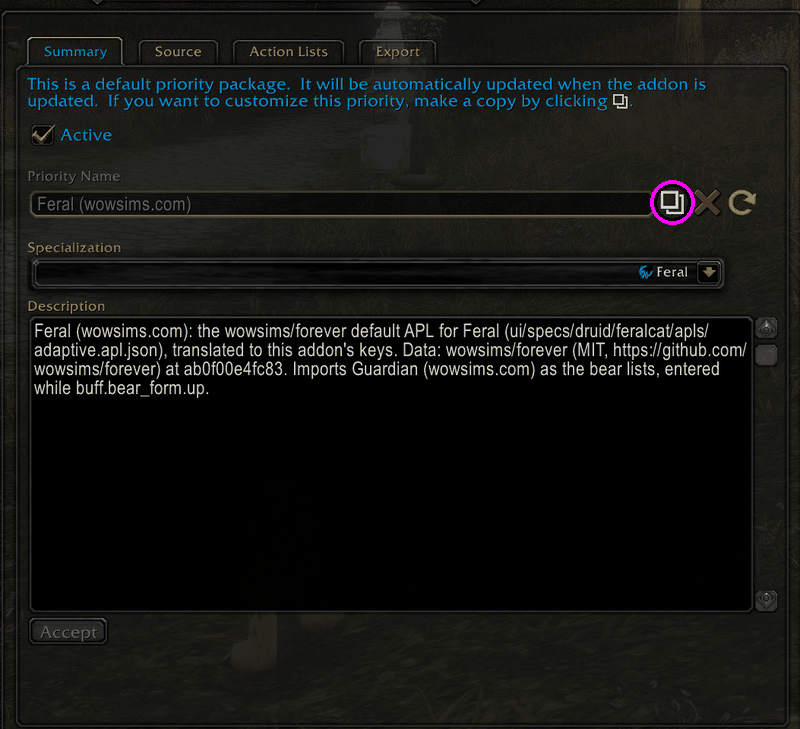

<!--
Purpose: Copy a built-in, change a line, test it with a snapshot, export it.
Type: Tutorial
Audience: theorycrafters
Prerequisites: [APL overview](APL-Overview).
-->
In this tutorial you copy the built-in Feral priority, change one of its lines, check the change with a snapshot and export the result as a share string. It takes about fifteen minutes, including a short fight. The steps use a Feral Druid; the same steps work for any specialization with a built-in priority.

Read [APL overview](APL-Overview) first if lists, lines and conditions are new to you.

## What you will have at the end

- A priority named "Feral (wowsims.com) (2)", active for Feral, identical to the built-in one except for its Faerie Fire line.
- The edited line: Faerie Fire is not recommended while you hold five combo points, so the points go to a finisher first.
- A share string of the priority that another player can import.

## Copy a built-in priority

1. Type `/hekili` to open the options.
2. Open **Priorities**, then Feral, then Feral (wowsims.com). The **Summary** tab opens, with a note that this is a default priority.
3. Click the copy icon to the right of **Priority Name**. It is the same copy icon the note on a built-in priority shows, and its tooltip reads Copy Priority.
4. Confirm. The copy, named "Feral (wowsims.com) (2)", opens on its own **Summary** tab.
5. Check **Active**. Hekili Forever now uses the copy for Feral.


<!-- Hekili Forever 0.11.0; Druid Feral; options, Priorities, Feral, Feral (wowsims.com), Summary tab (the built-in priority, before copying) -->

The copy is yours. It does not change when the addon updates the built-in priority ([Next steps](#next-steps)).

## Change a line

1. Open the **Action Lists** tab of the copy.
2. In **Action List**, choose `default`. In **Entry**, choose the first entry, Faerie Fire.
3. The **Conditions** box shows the line's condition:

   ```simc
   (action.faerie_fire.known&debuff.faerie_fire.remains<=0)&(!action.prowl.known|!buff.prowl.up)
   ```

4. Add `&combo_points.current<5` at the end, so that the box reads:

   ```simc
   (action.faerie_fire.known&debuff.faerie_fire.remains<=0)&(!action.prowl.known|!buff.prowl.up)&combo_points.current<5
   ```

5. Click Accept under the box. The change takes effect at once.

Written as a line of text, the entry is now:

```simc
actions=faerie_fire,if=(action.faerie_fire.known&debuff.faerie_fire.remains<=0)&(!action.prowl.known|!buff.prowl.up)&combo_points.current<5
```

If the condition has a typing error, an error appears in **Warnings** and the line is never chosen. Check the text against the box above.

## Test it

1. Close the options and attack an enemy in the open world. Forever has no target dummies.
2. Build five combo points while Faerie Fire is missing from the target, so that the edited line matters.
3. Type `/hekili snapshot`.
4. Open `/hekili` again, then **Snapshots (Troubleshooting)**, and choose the newest snapshot in **Select a Snapshot**.
5. Find the `faerie_fire` entry of the `default` list. Its criteria read FAILS, with `combo_points.current` shown as 5. A finisher is recommended instead.

From an abridged snapshot of the built-in Feral (wowsims.com) priority, the `faerie_fire` entry of the second recommendation, shortened with `...`:

```text
RECOMMENDATION #2 ( Offset: 0.00, GCD: 1.30, Casting: 0.00 ).

        6.   faerie_fire ( default - 3 )
        The action (faerie_fire) is usable at (0.00 + 1.30) with cost of 95 mana (have 2506).
         - the action is ready before the current recommendation (at +1.30 vs. +15.00).
         - this entry's criteria FAILS: ( ( action.faerie_fire.known[true] & debuff.faerie_fire.remains[38.70] <= 0 ) & ... )
        There were no recheck events to check.
```

The `criteria FAILS` line is the one to look for. It shows each value of the condition in square brackets. This excerpt is from the unedited priority, so the failing value is `debuff.faerie_fire.remains[38.70] <= 0`: the debuff still had 38.70 seconds left. In the snapshot of your edited line, read the same line for the value you changed.
<!-- Hekili Forever 0.11.0; Druid Feral; abridged snapshot of an out-of-combat test character -->

[Reading a snapshot](Reading-A-Snapshot) explains the rest of the snapshot.

## Export it

1. Open the **Export** tab of the copy.
2. Click in **Priority Export String**, press Ctrl+A to select the string, then Ctrl+C to copy it.
3. Paste the string where you want to share it.

Another player imports it in **/hekili > Priorities > Import / Export**, on the **Import** tab: paste it into **Import String** and click **Import Priority**. The priority's name, date and specialization then show in **Pack Name**, **Pack Date** and **Pack Specialization**; **Apply Changes** adds it, after a confirmation that names it. Like any copy, it then has to be made **Active**.

## Next steps

- **Your copy does not follow updates.** When a new version of the addon changes the built-in Feral priority, the copy keeps its old lines. Compare it with the built-in one after an update, and copy again if you want the new version ([wowsims priorities explained](APL-wowsims-Packs-Explained#a-copy-freezes)).
- **Write a priority from scratch.** In **/hekili > Priorities**, enter a **Priority Name**, choose the **Specialization** and click **Create New Pack**. Then paste text into **Priority (SimulationCraft Action Priority List)** on its **Source** tab and click **Import**. This short Feral priority imports with no warnings:

  ```simc
  actions.precombat=cat_form,if=!buff.cat_form.up
  actions=cat_form,if=!buff.cat_form.up
  actions+=/faerie_fire,if=!debuff.faerie_fire.up&combo_points.current<5
  actions+=/rip,focus=2,if=combo_points.current>=5&!debuff.rip.up
  actions+=/ferocious_bite,if=combo_points.current>=5&debuff.rip.remains>6
  actions+=/rake,focus=2,if=!debuff.rake.up
  actions+=/shred,focus=1,if=buff.clearcasting.up&!target.is_targeting_player
  actions+=/claw
  ```

  None of its lines tests energy: each line already waits until its cost is there ([APL overview](APL-Overview#the-walk-and-the-forecast)).
- Look up the expressions in [APL expression reference](APL-Expression-Reference) and the line options in [APL line options](APL-Line-Options).

## See also

- [APL priority editor](APL-Priority-Editor)
- [APL debugging](APL-Debugging)
- [Profiles and sharing](Profiles-And-Sharing)
